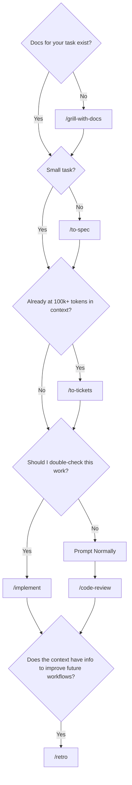

# Modified Skills for solo dev

> Matt Pocock writes great skills but they're more for teams

## Install

```sh
npx skills add CodaBool/agents -g -a claude-code -a codex -y
```

> update
```sh
npx skills update -g
```

## Manual Installs

- npx skills add https://github.com/vercel-labs/agent-browser --skill agent-browser -a claude-code -a codex -g
  - npm install -g agent-browser --allow-scripts=agent-browser && agent-browser install

## Skills



<!-- SKILLS_TABLE_START -->
| Skill | Description | Invocation |
| --- | --- | --- |
| [grill-me](skills/grill-me/SKILL.md) | A relentless interview to sharpen a plan or design. | manual |
| [grill-with-docs](skills/grill-with-docs/SKILL.md) | A relentless interview to sharpen a plan or design, which also creates docs as we go. | manual |
| [handoff](skills/handoff/SKILL.md) | Compact the current conversation into a handoff document for another agent to pick up. | manual |
| [implement](skills/implement/SKILL.md) | Implement a piece of work based on a spec | manual |
| [retro](skills/retro/SKILL.md) | Conduct a retrospective on a coding session. | manual |
| [to-spec](skills/to-spec/SKILL.md) | Turn the current conversation into a spec and publish it to docs/specs/: no interview, just synthesis of what you've already discussed. | manual |
| [to-tickets](skills/to-tickets/SKILL.md) | Break a plan, spec, or the current conversation into a set of tracer-bullet tickets, each declaring its blocking edges, published as sections in a single local docs/tickets.md | manual |
| [code-review](skills/code-review/SKILL.md) | Review the changes since a fixed point (commit, branch, tag, or merge-base) along two axes: Quality and Spec (does the code match what the documented spec says). Runs both reviews in parallel sub-agents and reports them side by side. Use when the user wants to review the code mentioning MR, PR, merging, pushing. | auto |
| [diagnosing-bugs](skills/diagnosing-bugs/SKILL.md) | Diagnosis loop for hard bugs and performance regressions. Use when the user says "diagnose"/"debug this", or reports something broken/throwing/failing/slow. | auto |
| [domain-modeling](skills/domain-modeling/SKILL.md) | Clarify a project's domain model during design or implementation. Use for ambiguous terminology, entity relationships, business rules, or conflicts between a feature spec and code. | auto |
| [grilling](skills/grilling/SKILL.md) | Grill the user relentlessly about a plan, decision, or idea. Use when the user wants to stress-test their thinking, or uses any 'grill' trigger phrases. | auto |
| [playwright-browser](skills/playwright-browser/SKILL.md) | browser automation CLI. Chrome via CDP with compact element refs. | auto |
| [prototype](skills/prototype/SKILL.md) | Build a throwaway prototype to answer a design question. Use when the user wants to sanity-check whether a state model or logic feels right, or explore what a UI should look like. | auto |
| [research](skills/research/SKILL.md) | Investigate a question against high-trust primary sources and capture the findings as a Markdown file in the repo. Use when the user wants a topic researched, docs or API facts gathered, or reading legwork delegated to a background agent. | auto |
| [tdd](skills/tdd/SKILL.md) | Test-driven development. Use when the user wants to build features or fix bugs test-first, or wants integration tests. | auto |
| [wizard](skills/wizard/SKILL.md) | Generate an interactive bash wizard that walks a human through steps only they can perform. Use when provisioning infrastructure, setting up credentials or CI secrets, walking an unfamiliar third-party dashboard, or running a one-off migration or cutover. Don't invoke this for steps the agent can perform itself. | auto |
| [writing-for-agents](skills/writing-for-agents/SKILL.md) | Writing documents for agents. Use when creating or editing skills, or modifying AGENTS.md. | auto |
<!-- SKILLS_TABLE_END -->
